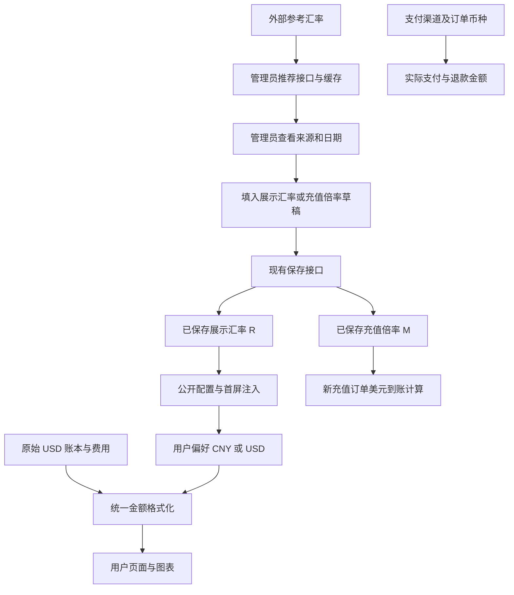

# 人民币／美元展示切换与充值倍率推荐 Implementation Plan

> **执行要求：** 按本文的阶段、接口契约和验收项逐步开发。先维护状态，再实施；每完成一阶段补充验证证据。遵守项目 `AGENTS.md`，仅在用户明确要求时提交或部署。

**Goal:** 保留美元账本和既有计费公式，支持用户默认人民币折合展示及美元切换，并在管理员支付设置提供最新参考汇率和可审查的充值倍率推荐。

**Architecture:** 业务金额继续以既有 USD 数值存储和计算；支付金额继续以支付渠道／订单币种结算；展示转换使用管理员已经保存的 USD→CNY 汇率。外部参考汇率只提供建议，管理员采纳到草稿并保存后才影响相应配置。

**Tech Stack:** Go / Gin / Ent / PostgreSQL / shopspring/decimal；Vue 3 / TypeScript / Pinia / vue-i18n / Tailwind；Go test / Vitest / Vue Test Utils。复用现有依赖。

**日期：** 2026-11-10。

**状态：** Task 1–8 已实现并完成本地回归与浏览器验收；尚未执行生产迁移、部署或配置调整。

**适用范围：** 用户端余额及费用展示、管理员支付设置、关联金额精度与接口。

**取代说明：** 本文是两个功能的统一开发依据，取代之前仅覆盖推荐功能的本地草稿 `2026-11-10-payment-exchange-rate-recommendation-design.md`。

---

## 1. 背景与目标

用户当前设置 `1 CNY = 1 USD`，页面混用了人民币实付金额和美元余额符号。用户希望：

1. 普通用户优先看到人民币金额，能切换为美元。
2. 管理员无需手算倒数，就能看到可解释的充值倍率建议。
3. 充值、余额、调用费用、模型售价及配额使用一致的单位说明。
4. 调整倍率保留人工控制，不由后台行情刷新直接修改生效配置。

“实时推荐”在首版定义为“获取最新公布的参考汇率并计算推荐值”，不是逐秒外汇报价。界面使用“最新参考汇率”，明确来源、汇率日期和获取时间。

### 1.1 已核实的现状

| 位置 | 已确认行为 | 开发影响 |
| --- | --- | --- |
| `backend/internal/service/payment_amounts.go` | 到账 = 输入支付金额 × 充值倍率，当前美元到账四舍五入到两位 | 推荐倍率精度与实际入账精度必须分别处理 |
| `backend/internal/service/gateway_usage_billing.go` | 余额、订阅及用户 Key 配额按 `ActualCost` 累加／扣减 | 切换展示不得改计费金额 |
| `backend/internal/service/payment_order.go` | 订阅购买有独立 USD→CNY 支付换算配置 | 不得默认覆盖既有订阅规则 |
| `backend/ent/schema/user.go` | 余额／冻结余额为 `decimal(20,8)` | 可保留八位美元额度 |
| `backend/ent/schema/payment_order.go` | 到账、实付、赠送、退款等现有金额字段多为 `decimal(20,2)` | 调整精度时按字段语义迁移，不能统一改所有金额 |
| `frontend/src/components/layout/AppHeader.vue` | 顶部余额写死 `$` | 接入统一格式化 |
| `frontend/src/components/payment/AmountInput.vue` | 自定义金额前缀写死 `$`，已有支付币种参数 | 输入金额符号应使用支付币种 |
| `frontend/src/components/modelPlaza/ModelPlazaContent.vue` | 同时展示本站售价和官方参考价；本站价已应用相关倍率 | 币种换算不能重复应用计费倍率 |
| `frontend/src/views/user/UsageView.vue` | 与管理员共享费用表格；CSV 保留原始费用 | 必须区分展示场景及导出单位 |
| `backend/internal/service/notification_email_service.go` 等 | 默认邮件仍有写死美元符号 | 无前端偏好时使用站点默认展示配置 |

以上是代码语义核实，不代表已经修改生产设置或完成发布。

## 2. 金额、汇率与业务规则

### 2.1 三种金额必须分开

| 类型 | 存储／计费单位 | 展示规则 |
| --- | --- | --- |
| 用户钱包、冻结额度、实际计费用量、Key 配额、订阅使用额度 | 既有 USD | 按用户偏好展示 USD 或按已保存汇率折合 CNY |
| 充值输入、支付、手续费、现金退款 | 支付渠道或历史订单币种 | 始终显示真实支付币种，不受顶部切换影响 |
| 官方模型参考价、上游账号采购成本 | 原始币种 | 明确标注币种；人民币参考值只能注明“折合” |

订阅用量的 `actual_cost` 表示消耗额度，不应统一称作“本次现金实扣”。后台用户余额调整使用同一美元账本；上游账号余额不属于用户钱包。

### 2.2 公式与示例

设：

- `R`：已保存的展示换算率，单位为 CNY / USD。
- `M`：已保存的充值倍率，单位为 USD / 支付单位；本功能只推荐 CNY 支付通道下的值。
- `U`：账本中原始 USD 金额。
- `P`：人民币充值输入金额。

```text
人民币折合展示金额 = U × R
美元展示金额       = U
推荐充值倍率       = round(1 / 最新参考 USD→CNY 汇率, 8)
基础美元到账金额   = P × M
```

例子仅用于测试，不是当前行情：`R = 7.20` 时，建议 `M = 0.13888889`；支付 CNY 72，基础到账约 USD 10，默认视图折合 CNY 72；调用计费 USD 0.10，则折合 CNY 0.72。

充值赠送、折扣和手续费沿用各自业务规则，不混入展示汇率。允许管理员有意配置 `M ≠ 1/R`，但必须展示支付、基础到账、优惠及折合到账的预览；不强制其互为倒数。

**价格影响：** 把 `M` 从 1 调整为 `1/R`，在其他模型价格、计费倍率及优惠不变时，会使相同调用量的人民币购买成本变为原来的约 `R` 倍。参考展示切换不产生这一影响；保存新的充值规则会产生。推荐区域提供该差异说明和示例，不擅自同步修改模型／分组倍率。

### 2.3 本期边界

- 支持 CNY / USD 两种展示偏好，不建立两套真实钱包。
- 使用人工保存的站内固定换算率；获取推荐不改变已保存的汇率。
- 不按外部行情自动批量重估账本或改写旧余额。
- 不自动定时修改充值倍率、订阅汇率或模型价格。
- 现有充值倍率是全渠道共用配置，本期保留其计费语义。推荐值只适用于人民币支付；存在启用的非 CNY 渠道或渠道读取未成功时，禁用“填入充值倍率”和“同时填入两项”，保留“填入展示汇率”。不建立独立的多币种充值倍率，也不自动更改非人民币渠道规则。
- 历史消费首版按当前已保存汇率给出折合值，明确标注口径；历史固定汇率报表／新增调用汇率快照作为后续独立需求。

## 3. 配置与生效规则

### 3.1 新增站点配置

| 字段 | 类型／默认值 | 含义 |
| --- | --- | --- |
| `billing_default_display_currency` | `CNY` 或 `USD`；默认 `CNY` | 用户未选择时的首选展示币种 |
| `billing_usd_to_cny_rate` | 有限正数；默认 `0` 表示未配置 | 站点已经保存的展示汇率 |

继续使用：

- `payment_balance_recharge_multiplier`：充值到账计算配置，精度不得被截成两位。
- `payment_subscription_usd_to_cny_rate`：既有订阅实际支付换算配置，保留 `0 = 未启用` 语义。

新配置通过既有管理员设置读写接口持久化，并同时进入公开设置接口、HTML 首屏注入、前端类型和设置缓存。不得只改公开 JSON 而遗漏首屏注入。

### 3.2 有效币种选择

```text
用户本地已保存偏好 → 站点默认展示币种
所选币种为 CNY 且 R 未配置／非法 → 实际回退 USD，并提示人民币换算未配置
```

首次访问且已有合法 `R` 时默认人民币。汇率尚未配置时保留正确的美元金额，不把 USD 数字直接标为 `¥`。用户选择 USD 后刷新仍保留 USD，不被默认值覆盖。

用户偏好保存在站点 localStorage 专用键 `ggbond:billing-display-currency`，站内页面共享响应式状态；localStorage 不可用时保留内存偏好。语言设置与币种偏好独立。跨设备偏好同步不属于首版。

### 3.3 草稿、采纳、保存

推荐接口结果独立于已保存设置。管理员可以选择：

1. “填入充值倍率”：只修改草稿 `M`。
2. “填入展示汇率”：只修改草稿 `R`。
3. “同时填入两项”：修改草稿 `R` 和 `M`，方便首次配置。

三种操作均通过现有“保存”才生效。订阅汇率保留独立输入；不因为点击上述按钮而静默启用或覆盖订阅换算。更新设置失败时不能提前更新公开缓存。

## 4. 交互与页面覆盖

### 4.1 顶部切换

- 在顶部余额附近增加明确的“人民币 CNY / 美元 USD”选择，具有当前状态和可访问名称，支持键盘操作。
- 选择后立即更新同一视图中的余额、费用、图表和配额。
- 人民币余额提供“按站点汇率折合；1 USD = R CNY”的说明。
- 账户余额不足或负数、零、小额、空值沿用明确的格式化规则。
- 首屏使用注入配置及本地偏好初始化，避免先错误展示币种再闪烁。

### 4.2 金额覆盖清单

| 场景 | 必须覆盖 |
| --- | --- |
| 公共布局与概览 | 顶部可用／冻结／总余额，控制台统计、最近调用和图表提示 |
| 用户消费与额度 | 用量明细、实际计费及原始费用说明、Key 额度／限额、公开 Key 查询、平台限额 |
| 充值及订单 | 输入框按支付币种；基础到账／赠送按偏好；实付／退款按订单币种；支付成功结果 |
| 订阅与兑换 | 日／周／月已用及限额、充值兑换结果、余额兑换历史 |
| 邀请返利与个人资料 | 可转余额、返利额度、余额不足阈值及金额说明 |
| 本站模型售价 | token 输入／输出／缓存、按请求／图片／视频计价、阶梯及定时计价 |
| 管理端关联钱包 | 用户余额查询／调整／历史、用户费用等；上游采购金额明确使用原币种 |
| 非页面输出 | CSV 单位说明、通知邮件、缺少 localStorage 时的默认行为 |

官方价格保留明确 USD 原价；如展示人民币参考值，应和官方原始币种分别标注。共享 `UsageTable`、图表、`formatScaled` 等不能无上下文地全局替换 `$`。

### 4.3 支付流程示例

选中美元视图、支付宝支付时，页面应展示：

```text
充值输入金额：¥72.00
实际支付：¥72.00
到账余额：$10.00（示例；不含优惠与手续费）
```

切换到人民币视图，只将到账余额显示为“折合 ¥72.00”，输入值、支付请求金额及订单币种保持原样。历史订单亦如此。

### 4.4 可编辑配额

Key 配额、用户余额操作及固定金额提醒等表单必须显式标明输入单位。首版可继续以 USD 编辑并明确写出 `USD`，同时给出人民币预览；若支持按所选币种编辑，必须提供双向转换、提交前单位归一和往返精度测试。不得仅替换输入框符号而继续原数提交。

### 4.5 导出和通知

- CSV 保留原始 USD 数值及明确币种列；增加 CNY 折合列时附带所用 `R`，不得改变旧列含义。
- 邮件没有浏览器偏好，采用站点默认币种与已保存汇率，并保留美元原值说明。
- 默认邮件模板与 legacy 余额提醒实现均需核查；自定义模板不覆盖正文，增加可选格式化变量并保持旧变量兼容。

## 5. 推荐汇率接口契约

### 5.1 来源与请求

后端固定请求 `https://api.frankfurter.dev/v2/rate/USD/CNY?providers=ecb`。官方资料：`https://frankfurter.dev/`、`https://api.frankfurter.dev/v2/openapi.json`。本次开发已直接核对官方文档并验证该 URL 返回 `date/base/quote/rate`。

仅后端请求该固定公开来源，不携带管理员 token、用户资料或支付凭据；不接受用户提供的 URL。来源为参考报价，不能承诺银行最终结算价。

### 5.2 管理接口

```http
GET /api/v1/admin/settings/payment-exchange-rate
```

使用现有管理员鉴权；未登录／非管理员不能读取。仅返回建议，不写配置或触发支付。

示例响应（数字为测试值）：

```json
{
  "code": 0,
  "message": "success",
  "data": {
    "usd_to_cny": 7.2,
    "balance_recharge_multiplier": 0.13888889,
    "rate_date": "2026-11-09",
    "fetched_at": "2026-11-10T10:00:00Z",
    "source": "Frankfurter / ECB",
    "stale": false
  }
}
```

- 超时／无有效缓存时返回 HTTP 503，原因 `EXCHANGE_RATE_UNAVAILABLE`。
- `rate_date` 是上游报价日期，`fetched_at` 是本服务最后成功获取时间，两者不得混用。
- 接口不把当前业务倍率伪装成外部参考值，不在失败时编造推荐值 1。

### 5.3 校验与缓存

- 校验 `base=USD`、`quote=CNY`、正数有限汇率和日期；拒绝错误币种方向、非法值、未来日期及超过七天的报价。
- 现有实现对异常汇率上限 1000 采取拒绝策略，接口变更时同步测试和文档。
- 八秒请求超时、8 KiB 响应上限、禁止重定向。
- 正常成功缓存 30 分钟，同一进程并发刷新合并；页面刷新不保证绕过服务端缓存，界面明确写出缓存策略。
- 上游失败时最多展示 24 小时内获取的旧缓存，`stale=true`，失败后两分钟重试退避。
- 陈旧或刷新失败时禁用一键填入，管理员仍可手工编辑；旧缓存不得显示为新获取报价。
- 进入支付设置时加载，离开／销毁后避免过期响应覆盖新的状态，不持续后台轮询行情。

## 6. 精度、历史数据与生产边界

### 6.1 精度

1. 汇率及充值倍率配置保留至少八位有效小数，使用现有 decimal 工具计算倒数；保存和重新读取保持一致。
2. 钱包账本精度继续采用八位 USD。基础到账及赠送的计算中间值不能提前四舍五入到两位。
3. 订单中属于“美元到账／赠送／账本退款额度”的字段与兑换中转字段应共同审查并迁移到八位；真实现金支付与网关退款字段按支付币种最小单位处理。
4. 现有充值履约通过兑换码入账，必须核对订单、兑换码、钱包和退款金额一致性；不能只改订单字段。
5. 展示末端才格式化。钱包余额通常两位，调用费用保留六位或更多，模型单价沿用可表达小额价格的精度，倍率推荐八位。
6. 汇率更新不重新四舍五入或写回美元账本。

### 6.2 历史及权益

- 旧美元余额不自动乘除汇率。例如 USD 63.24 在示例汇率 7.20 下显示折合 CNY 455.33，内部仍为 63.24。
- 旧余额来自原 1:1 规则，这是已形成的权益，不能因上线切换功能而静默缩减。
- 旧订单、旧赠送、旧退款保留原有数值与币种；精度扩展不回算旧金额。
- 变更充值倍率只用于后续新建订单，已创建订单按自身保存的金额履约，不能支付回调时重新取新倍率。
- 历史用量显示“按当前站内汇率折合”，不称为当时现金实付；要提供历史固定 CNY 报表须另建汇率快照设计。

### 6.3 发布操作

开发与测试不得直接修改生产充值倍率、旧余额或部署。部署及生产汇率调整依照用户单独授权执行。计划执行中不得自动提交、推送或合并。

## 7. 数据流



外部参考接口与已保存配置之间只能通过管理员采纳和保存连接。用户切换展示的路径不能进入扣费或支付金额计算。

## 8. 分阶段任务与文件清单

每项先补能暴露问题的测试，再作最小实现，测试通过后更新第 10 节状态。未完成项不勾选，不重复重写已经验证的部分。

### Task 1：推荐服务与倍率精度

**涉及文件：**

- 已新增：`backend/internal/service/payment_exchange_rate.go`、`payment_exchange_rate_test.go`。
- 已新增：`backend/internal/handler/admin/setting_handler_exchange_rate.go`。
- 修改：`backend/internal/handler/admin/setting_handler.go`、`backend/internal/server/routes/admin.go`。
- 修改／测试：`backend/internal/service/payment_config_service.go`、`payment_config_service_test.go`。
- 已新增：`backend/internal/server/routes/payment_exchange_rate_routes_test.go`。

**步骤：**

1. 核对既有推荐实现与第 5 节契约，补充并发、超时和取消覆盖。
2. 验证倒数、币种方向、异常日期、缓存及失效行为。
3. 验证保存八位倍率后重新读取仍一致，其他金额配置不受影响。
4. 运行推荐和路由测试后记录证据。

### Task 2：展示配置从后端贯通到首屏

**涉及文件：**

- `backend/internal/service/setting_service.go`、`settings_view.go`、`setting_parse.go`、`setting_update.go`、`setting_public.go`。
- `backend/internal/handler/admin/setting_handler.go`、`setting_handler_update.go`。
- `backend/internal/handler/dto/settings.go`、`backend/internal/handler/setting_handler.go`。
- `frontend/src/api/admin/settings.ts`、`frontend/src/types/index.ts`、`frontend/src/stores/app.ts`。
- 相邻设置往返测试、`backend/internal/handler/dto/public_settings_injection_schema_test.go`、`frontend/src/__tests__/publicSettingsInjection.spec.ts`。

**步骤：**

1. 写默认值、非法汇率、非法币种、遗漏字段不覆盖及往返保存测试。
2. 增加设置定义／解析／更新／DTO／公开配置与注入字段。
3. 前端初始化与缓存路径同样增加字段，避免首屏配置漂移。
4. 验证没有 `R` 的旧部署安全回退 USD。

### Task 3：管理员推荐组件与统一草稿

**涉及文件：**

- `frontend/src/components/admin/settings/PaymentExchangeRateRecommendation.vue` 及相邻测试。
- `frontend/src/views/admin/SettingsView.vue` 及相邻测试。
- `frontend/src/api/admin/settings.ts`、`frontend/src/api/__tests__/settings.paymentExchangeRate.spec.ts`。
- `frontend/src/i18n/locales/zh/admin/settings.ts`、`frontend/src/i18n/locales/en/admin/settings.ts`。

**步骤：**

1. 保留现有倍率推荐，增加展示汇率与默认展示币种表单。
2. 增加第 3.3 节的三个填入动作，明确填入和保存的区别。
3. 增加来源／缓存／时间、失败与陈旧状态、示例和现有值差异说明。
4. 验证自动加载没有 PUT；填入只改草稿；保存后配置及公开缓存一致。
5. 修复现存用户充值倍率预览测试的两位精度旧断言，并添加八位倍率用例。

### Task 4：统一金额转换与用户偏好

**计划新增：**

- `frontend/src/utils/billingCurrency.ts` 及 `frontend/src/utils/__tests__/billingCurrency.spec.ts`。
- `frontend/src/composables/useBillingCurrency.ts` 及相邻测试。
- `frontend/src/components/common/CurrencySwitcher.vue` 及相邻测试。

**修改：** `frontend/src/components/layout/AppHeader.vue`，中英文公共文案。

**步骤：**

1. 定义纯转换方法，输入原始 USD、目标币种、已保存 `R`，禁止隐式再应用计费倍率。
2. 定义钱包／费用／单价所需精度、非数字／负数／零／极小值规则；缺汇率时回退 USD。
3. 增加响应式共享偏好，正确处理默认值、本地缓存损坏、存储异常与语言独立性。
4. 接入顶部切换，测试切换和刷新均不发送业务写请求。

### Task 5：充值精度与订单／退款契约

**涉及文件：**

- `backend/internal/service/payment_amounts.go`、`payment_recharge_bonus.go`、`payment_fulfillment.go`、`payment_refund.go` 及相邻测试。
- `backend/ent/schema/payment_order.go`、`redeem_code.go` 及必要的下一序号 SQL migration。
- `frontend/src/utils/rechargeBonus.ts` 及相邻测试。

**步骤：**

1. 先记录 USD 到账／赠送／额度退款和现金字段的明确映射，再决定迁移范围。
2. 写非整除汇率、赠送、折扣、手续费、部分退款、幂等履约及旧订单回归测试。
3. 提高美元额度精度；同步迁移和必要的 Ent 生成产物，不新增依赖。
4. 逐段核对报价、订单、兑换码中转、钱包及退款数值一致。

### Task 6：余额、用量、Key 和图表

**涉及文件组：**

- `frontend/src/components/user/dashboard/UserDashboardStats.vue`、`UserDashboardRecentUsage.vue`、`UserDashboardCharts.vue`。
- `frontend/src/views/user/UsageView.vue`、`KeysView.vue`、`frontend/src/views/KeyUsageView.vue`。
- `frontend/src/components/admin/usage/UsageTable.vue` 和 `frontend/src/components/charts/` 中相关费用组件。
- 个人资料、用户平台额度、共享用户费用单元格及对应测试。

**步骤：**

1. 按第 4.2 节分类迁移格式化，表格正文、提示、图例与统计保持一致。
2. 金额查询、排序及分页继续采用原始数值；展示切换不重复请求或改过滤含义。
3. 覆盖共享组件的用户／管理员场景，保留采购成本原币种。
4. CSV 明确单位；测试切换前后原始计费数据不变。

### Task 7：支付、订阅、兑换、返利和价格页

**涉及文件组：**

- `frontend/src/components/payment/AmountInput.vue`、`PaymentStatusPanel.vue`、`OrderTable.vue`、`SubscriptionPlanCard.vue`。
- `frontend/src/views/user/PaymentView.vue`、`UserOrdersView.vue`、`SubscriptionsView.vue`、`RedeemView.vue`、`AffiliateView.vue`。
- `frontend/src/components/modelPlaza/ModelPlazaContent.vue`、`frontend/src/components/channels/PricingRow.vue`、相关售价工具。
- 相关 Key／提醒阈值输入和管理员用户余额表单。

**步骤：**

1. 充值输入与支付按钮使用真实支付币种；到账和赠送使用用户偏好。
2. 本站售价先按既有倍率算好再换算；官方参考价明确标注原币种。
3. 订阅支付仅受既有订阅设置影响，额度展示按偏好。
4. 覆盖第 4.4 节所有可编辑金额，确保提交单位为接口要求的 USD 或原支付币种。

### Task 8：通知、说明文档与联合验收

**涉及文件：**

- `backend/internal/service/notification_email_service.go`、`balance_notify_service.go` 及测试。
- `docs/guides/PAYMENT_CN.md`、`docs/guides/PAYMENT.md`、`docs/api/ADMIN_PAYMENT_INTEGRATION_API.md` 中受影响章节。
- 本文及 `docs/README.md`。

**步骤：**

1. 默认通知使用站点币种与显式单位；自定义邮件保持兼容。
2. 更新配置方向、推荐与生效的区别、历史权益及支付金额不随切换变化的使用说明。
3. 完成第 9 节验收，在本地浏览器核对桌面／窄屏及浅色／深色界面。
4. 记录真实验证证据与待发布事项。部署／提交仅在用户要求时执行。

## 9. 验收标准与验证命令

### 9.1 功能验收

| 编号 | 验收要求 |
| --- | --- |
| C01 | 有合法 `R` 且无用户偏好，默认 CNY；切换后刷新保持偏好 |
| C02 | 缺失／非法 `R` 时正确回退 USD，不把原始数字误标人民币 |
| C03 | 固定示例 `R=7.20`：USD 10 → CNY 72，USD 0.10 → CNY 0.72；原始金额不变 |
| C04 | 所有用户金额及图表一致更新；官方／上游成本币种说明准确 |
| C05 | 充值输入、实付、手续费、退款和历史订单遵守真实支付币种 |
| C06 | Key 等可编辑金额的单位与提交值一致，不因展示切换扩大或缩小额度 |
| R01 | 进入支付设置加载推荐，显示来源、报价日期、获取时间及缓存说明 |
| R02 | 7.20 的推荐倍率为 0.13888889，保存重读仍一致 |
| R03 | 获取／刷新推荐不写配置；三个填入动作只改相应草稿 |
| R04 | 故障、超时、异常响应、过期报价有明确状态，不编造 1 或使用错误方向 |
| R05 | 缓存只在规定期限复用；陈旧报价禁用一键采纳；推荐接口要求管理员鉴权 |
| P01 | 非整除汇率充值及赠送不被提前截成两位 USD，前后端报价与到账一致 |
| P02 | 退款、兑换码入账及幂等回调保持金额一致；旧订单不按新倍率重算 |
| H01 | 旧余额数值与权益不变，历史支付金额／币种不变，折合报表口径明确 |
| I01 | 中英文文案键完整，推荐填入操作与实际生效状态明确 |
| U01 | 桌面／窄屏／浅深色模式无溢出；切换、加载、失败及重试可操作 |

### 9.2 已存在测试的针对性命令

在 `backend/` 下运行：

```bash
go test -tags=unit ./internal/service ./internal/handler/admin ./internal/server/routes -run 'TestPaymentExchangeRate|TestUpdatePaymentConfig_PreservesRechargeMultiplierPrecision' -count=1
```

在 `frontend/` 下运行：

```bash
pnpm exec vitest run src/components/admin/settings/__tests__/PaymentExchangeRateRecommendation.spec.ts src/api/__tests__/settings.paymentExchangeRate.spec.ts src/views/admin/__tests__/SettingsView.spec.ts src/views/user/__tests__/PaymentView.spec.ts src/i18n/__tests__/localeKeyCompleteness.spec.ts
pnpm exec vue-tsc --noEmit
```

Task 2/4/5 等新增测试后，将其加入针对性命令；预期为相关断言全通过，不允许把当前失败当作通过。最终执行项目适用的 lint、typecheck、构建和回归测试：

```bash
pnpm run lint:check
pnpm run typecheck
pnpm run build
```

构建或现有全量检查若出现与本功能无关的失败，记录原始证据与归因，避免扩大改动。无新增功能变更时不反复运行已经通过的检查。

## 10. 实施进度与已有验证证据

更新于 2026-11-10。以下为本地开发验收记录，不代表已发布。

| 项目 | 当前状态 | 证据／下一步 |
| --- | --- | --- |
| Task 1：推荐服务与倍率保存 | 已完成 | 固定来源、方向／日期校验、8 秒超时、缓存／并发／故障、管理员路由及完整精度保存重读测试 |
| Task 2：设置及首屏注入 | 已完成 | 两个新配置贯通后台、公开接口、HTML 注入和前端缓存；往返、遗漏字段、非法值、旧部署回退测试 |
| Task 3：推荐与草稿 | 已完成 | 三种填入动作、失败与陈旧状态、来源／日期／缓存、价格影响；非 CNY 渠道阻止倍率一键填入 |
| Task 4：币种偏好及工具 | 已完成 | 共享响应式偏好、本地持久化、默认 CNY、无汇率回退、极小／负数／零金额及无网络写入测试 |
| Task 5：入账／退款精度 | 已完成代码与本地测试 | USD 到账／赠送／退款额度保留八位，迁移 250、Ent 元数据、兑换码履约幂等及现金退款查询换算测试；未在 PostgreSQL 实库执行迁移 |
| Task 6–7：页面及模型价格 | 已完成 | 余额、费用、Key、图表、订阅额度、兑换、邀请、订单；实付保持原币种；本站模型价换算一次，官方价标 USD |
| Task 8：通知、导出、文档 | 已完成 | CSV 原值列明确 USD；默认通知采用站点配置并保留原值，自定义变量兼容；中英文指南及接口文档更新 |
| Go 针对性检查 | 已通过 | migrations、service、routes、dto 命中测试通过；admin handler 编译通过，该筛选未命中该包测试 |
| 前端主要回归 | 已通过 | 30 文件、362 项；新增混合渠道保护后 3 文件、58 项通过；退款与 Key 补充 2 文件、31 项通过（测试集合有重叠，不累计） |
| TypeScript／ESLint | 已通过 | `pnpm run typecheck`、全前端 `pnpm run lint:check`；末次改动另有针对性检查 |
| 生产构建 | 已通过 | `pnpm run build`；存在 Browserslist 数据过旧和 chunk 大小提示，未新增依赖 |
| 浏览器联合验收 | 已通过本地模拟接口验收 | 1440px／375px、浅色／深色；72 CNY ↔ 10 USD、刷新持久化、填入草稿无 PUT、展示率 7.2／倍率 0.13888889；窄屏无页面横向溢出 |
| 生产配置、旧余额、部署 | 未操作 | 未修改生产汇率或余额；未推送、部署；上线仍须迁移并单独保存目标配置 |
| 提交前审查修复 | 已完成并验证 | 充值页当前余额、批量生图冻结／结算金额、管理员用户排行费用补接币种切换；USD 通知保留八位原始金额；配置读取失败回退 USD 时记录事件类型与错误告警 |
| 审查后最终检查 | 已通过 | 前端 8 文件、72 项；全量 lint、typecheck、生产构建（含最终类型构建）；Go 针对性回归及通知精度补充回归；`git diff --cached --check` |

验证命令补充：

```bash
# backend/
go test -tags=unit ./migrations ./internal/service ./internal/handler/admin ./internal/server/routes ./internal/handler/dto -run 'TestPayment|TestCalculateRecharge|TestBillingDisplay|TestPublicSettingsInjection|Test.*BalanceLow|TestNotificationEmail|TestExecuteBalanceFulfillment|Test.*Refund|TestDuplicatePayment' -count=1
# frontend/
pnpm exec vitest run src/components/admin/settings/__tests__/PaymentExchangeRateRecommendation.spec.ts src/views/admin/__tests__/SettingsView.spec.ts src/i18n/__tests__/localeKeyCompleteness.spec.ts
pnpm exec vitest run src/components/admin/payment/__tests__/AdminRefundDialog.balance.spec.ts src/views/user/__tests__/KeysView.spec.ts
pnpm run lint:check
pnpm run typecheck
pnpm run build
```

本地日志：`/tmp/ggbond-currency-tests-final.log`、`/tmp/ggbond-backend-currency-tests-final.log`、`/tmp/ggbond-currency-mixed-channel-tests2.log`、`/tmp/ggbond-currency-final-extra-tests.log`、`/tmp/ggbond-currency-refund-query-tests.log`、`/tmp/ggbond-currency-build-complete.log`。浏览器截图位于忽略目录 `output/playwright/currency-{desktop,mobile}-{light,dark}.png`。页面接口为本地 fixture；尚未完成真实支付网关、真实外汇故障环境或生产 PostgreSQL 的上线验收。

审查后日志：`/tmp/ggbond-review-frontend-final.log`、`/tmp/ggbond-review-backend-final.log`、`/tmp/ggbond-review-email-tests.log`、`/tmp/ggbond-review-lint-final.log`、`/tmp/ggbond-review-typecheck.log`、`/tmp/ggbond-review-build-final.log`。用户已授权本轮审查后提交 Git；提交不包含生产配置变更。

## 11. 发布检查（2026-11-10）

用户已授权推送及部署。首轮发布 `v2026.11.10-3` 被 CI 阻止，未进入镜像发布或生产部署：汇率响应关闭缺少显式错误处理，两个管理员设置契约遗漏新公开字段，一个既有模型映射测试受到其他测试修改的全局配置影响。已补齐关闭处理、契约断言与测试配置隔离，并覆盖 Grok 跨客户端映射开启场景；定向 API 契约、汇率及模型映射测试通过。重新发布仍须通过完整 CI 与安全门禁。

迁移前已在生产 PostgreSQL 的临时表副本演练迁移 250：相关字段无超出新整数范围的数据，转换后金额逐项不变；事务已回滚，正式表未修改。实际部署仍由既有流程先生成并校验私有备份，再启动候选执行迁移。未修改生产展示汇率、充值倍率或余额。发布完成后以[部署记录](../../deploy/production/README.md)为准。
